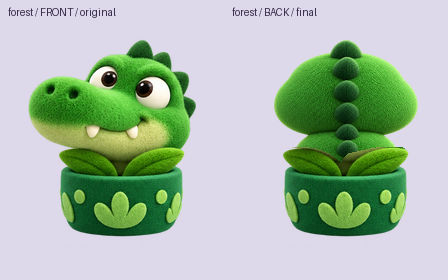

# 排队背面图（其余 18 位队员）

2026-11-01 21:13，用户确认：排队区第一排保持现在的样子（正面），**第 2、3 排改回背面**，不再用"花盆长苗"。走到第一排时队员原地转身，从背面转到正面。

10-29 已经试做了 4 位（小熊、水豚、小鸡、猫咪），见 `../BackView-20261029/`。这次补齐其余 18 位，**要求和那一批完全一样**，风格以那 4 张为准。

参考图在 `references/`：

- `<creatureId>-<色号>-idle.png`：每位队员现在的正面待机图，造型、颜色、花盆以它为准。
- `style-front-back-comparison.png`：上一批 4 位的正背面对照，背面的画法以它为准。

## 要求

1. **只转身子，不转花盆**：队员在花盆里转过去背对镜头，花盆和两片叶子保持正面不动。
2. **画布和位置**：224×256 RGBA 透明底，与参考图相同。脚线 y=212，头顶不高于 y=6。身体大小、位置、高度与参考图一致，轮廓基本重合，只是看到的是后背。
3. **花盆锁定**：y≥148（盆沿）以下的像素与参考图完全一致；两片叶子的位置、形状、颜色与参考图一致，画在身体前面。
4. **背面内容**：后脑勺和后背的毛绒，耳朵、角、头饰从背后看的样子，能看到的尾巴、翅膀尖、背上的花纹或龟壳等。**看不到眼睛、鼻子、嘴**。
5. **同一角色**：配色、毛绒质感、右上方柔光与参考图是同一套写实毛绒渲染。颜色和轮廓要一眼认得出是谁，因为排队时靠颜色认人。
6. 无文字、无背景、无投影，边缘干净。

## 18 位队员

| 动物 | 名字 | 色号 | 参考图 | 交付文件 |
| --- | --- | --- | --- | --- |
| 考拉 | 糯糯 | 42A9FF | `references/koala-42A9FF-idle.png` | `delivery/creatures/koala/42A9FF/back.png` |
| 狮子 | 卷卷 | FF9D30 | `references/lion-FF9D30-idle.png` | `delivery/creatures/lion/FF9D30/back.png` |
| 青蛙 | 呱呱 | 62E18E | `references/green-62E18E-idle.png` | `delivery/creatures/green/62E18E/back.png` |
| 小象 | 朵朵 | BD80FF | `references/purple-BD80FF-idle.png` | `delivery/creatures/purple/BD80FF/back.png` |
| 狐狸 | 桃桃 | FF525B | `references/red-FF525B-idle.png` | `delivery/creatures/red/FF525B/back.png` |
| 企鹅 | 团团 | 2D2D2D | `references/charcoal-2D2D2D-idle.png` | `delivery/creatures/charcoal/2D2D2D/back.png` |
| 浣熊 | 豆豆 | 696CAF | `references/slate-blue-696CAF-idle.png` | `delivery/creatures/slate-blue/696CAF/back.png` |
| 海豹 | 啾啾 | 46D9FF | `references/cyan-46D9FF-idle.png` | `delivery/creatures/cyan/46D9FF/back.png` |
| 河马 | 芋芋 | C8C5FF | `references/lavender-C8C5FF-idle.png` | `delivery/creatures/lavender/C8C5FF/back.png` |
| 小鹿 | 栗栗 | 9C225E | `references/berry-9C225E-idle.png` | `delivery/creatures/berry/9C225E/back.png` |
| 猴子 | 皮皮 | 65392D | `references/brown-65392D-idle.png` | `delivery/creatures/brown/65392D/back.png` |
| 猫头鹰 | 咕咕 | B672FD | `references/violet-B672FD-idle.png` | `delivery/creatures/violet/B672FD/back.png` |
| 刺猬 | 球球 | 92EF4D | `references/lime-92EF4D-idle.png` | `delivery/creatures/lime/92EF4D/back.png` |
| 乌龟 | 慢慢 | 30D183 | `references/mint-30D183-idle.png` | `delivery/creatures/mint/30D183/back.png` |
| 鳄鱼 | 咔咔 | 0C7E1C | `references/forest-0C7E1C-idle.png` | `delivery/creatures/forest/0C7E1C/back.png` |
| 兔子 | 糖糖 | FFC5E0 | `references/pink-FFC5E0-idle.png` | `delivery/creatures/pink/FFC5E0/back.png` |
| 小猪 | 哼哼 | FFCAA9 | `references/peach-FFCAA9-idle.png` | `delivery/creatures/peach/FFCAA9/back.png` |
| 绵羊 | 咩咩 | C5FFE4 | `references/pale-mint-C5FFE4-idle.png` | `delivery/creatures/pale-mint/C5FFE4/back.png` |

可以分批交，每批几位都行，程序做完一位就能接一位。

## 接入（程序已就绪）

- 图集脚本已把本目录 `delivery/` 加为毛绒素材来源，放入文件后正常构建即可。
- 有 `back` 图的队员排在第 2、3 排时显示背面；走到第一排时原地转身，从背面经侧身转到正面，约 0.36 秒。还没交背面图的队员暂时继续用"花盆长苗"。

## 交付与记录

- 生成原图存 `masters/`，提示词和生成次数记入 `prompts.json`。
- 全部交完后，在本文件末尾写自查：
  - 尺寸
  - 花盆（y≥148）和叶子与参考图逐像素一致的检查结果
  - 每位正背面并排的对照图，放在 `qa/`
  - 头顶、耳朵、角有没有被画布切掉；背面有没有露出五官

## 交付自查（2026-11-02）

18 位全部交付，每位一张 `delivery/creatures/<creatureId>/<色号>/back.png`。使用内置 `image_gen`，含咔咔返修共生成 **24 次**（18 次首稿、6 次修正）。原图存于 `masters/`，实际提示词和采用记录见 [prompts.json](prompts.json)。

- **尺寸与透明度**：18/18 为 224×256、RGBA PNG、透明背景。
- **花盆锁定**：重新打开实际交付 PNG 后比较完整 RGBA；每张 y≥148 的 24,192 个像素与对应正面参考完全相同，18 张差异总计 **0 像素**，包含全透明像素的 RGB。原脚线位置保留。
- **叶子锁定**：可见原叶片由参考图直接提取并置于新身体前面，位置、形状、颜色不重画；18 张叶片锁定区域差异总计 **0 像素**。掩膜保存在 `qa/*-leaf-lock-mask.png`。海豹保留前爪原来遮挡叶片的缺口，该处衔接新的后背/鳍。
- 18 张图在 y<6 处均完全透明，有效主体最高点在 y15～25。逐张检查了头顶、耳朵、鹿角、呆毛和背脊的完整性。返修后的咔咔收起了侧面的长嘴，上半身与正面轮廓的 IoU 为 79.99%。完整数据见 [validation.json](qa/validation.json)。
- **五官与风格**：18/18 没有眼睛、鼻子、嘴、牙齿等正面五官；保留对应配色和写实毛绒质感。青蛙/鳄鱼凸起处为纯毛绒背面；刺猬为软刺、乌龟为毛毡龟壳；耳背不露正面内耳。
- **接缝检查**：乌龟按原图较高的弧形盆沿单独合成，修复横向接缝；企鹅跨过锁定线的黑色外鳍与原像素平滑衔接；狮子鬃毛和刺猬软刺不误当作花盆前景。
- **透明边缘与缩小预览**：查看白底、蓝底下的 98×112 显示，未见明显底色块、投影或五官残留。此项为素材预览，不是游戏内实测。
- **复现检查**：运行 `python3 Art/PlushToy/BackView-All-20261101/compose.py` 后，18 张输出 SHA-256 完全相同。脚本只做配准、透明缩放及参考像素合成；毛绒背面来自生成原图。叶片来源掩膜及其校验记录已保存在本目录 `qa/source-leaf-masks/` 和 `qa/source-mask-manifest.json`。

检查详情见 [validation.json](qa/validation.json) 与 [visual-review.json](qa/visual-review.json)。

### 预览

- [18 位背面总览](qa/back-lineup.png)
- [第 1 批正背面对照](qa/batch-1-front-back.png)
- [第 2 批正背面对照](qa/batch-2-front-back.png)
- [第 3 批正背面对照](qa/batch-3-front-back.png)
- [白底/蓝底缩小预览](qa/queue-scale-preview.png)

| 队员 | 生成次数 | 交付 | 独立正背面对照 |
| --- | ---: | --- | --- |
| 考拉·糯糯 | 1 | [back.png](delivery/creatures/koala/42A9FF/back.png) | [对照图](qa/koala-front-back.png) |
| 狮子·卷卷 | 1 | [back.png](delivery/creatures/lion/FF9D30/back.png) | [对照图](qa/lion-front-back.png) |
| 青蛙·呱呱 | 1 | [back.png](delivery/creatures/green/62E18E/back.png) | [对照图](qa/green-front-back.png) |
| 小象·朵朵 | 1 | [back.png](delivery/creatures/purple/BD80FF/back.png) | [对照图](qa/purple-front-back.png) |
| 狐狸·桃桃 | 1 | [back.png](delivery/creatures/red/FF525B/back.png) | [对照图](qa/red-front-back.png) |
| 企鹅·团团 | 1 | [back.png](delivery/creatures/charcoal/2D2D2D/back.png) | [对照图](qa/charcoal-front-back.png) |
| 浣熊·豆豆 | 2 | [back.png](delivery/creatures/slate-blue/696CAF/back.png) | [对照图](qa/slate-blue-front-back.png) |
| 海豹·啾啾 | 1 | [back.png](delivery/creatures/cyan/46D9FF/back.png) | [对照图](qa/cyan-front-back.png) |
| 河马·芋芋 | 1 | [back.png](delivery/creatures/lavender/C8C5FF/back.png) | [对照图](qa/lavender-front-back.png) |
| 小鹿·栗栗 | 2 | [back.png](delivery/creatures/berry/9C225E/back.png) | [对照图](qa/berry-front-back.png) |
| 猴子·皮皮 | 2 | [back.png](delivery/creatures/brown/65392D/back.png) | [对照图](qa/brown-front-back.png) |
| 猫头鹰·咕咕 | 1 | [back.png](delivery/creatures/violet/B672FD/back.png) | [对照图](qa/violet-front-back.png) |
| 刺猬·球球 | 1 | [back.png](delivery/creatures/lime/92EF4D/back.png) | [对照图](qa/lime-front-back.png) |
| 乌龟·慢慢 | 1 | [back.png](delivery/creatures/mint/30D183/back.png) | [对照图](qa/mint-front-back.png) |
| 鳄鱼·咔咔 | 3 | [back.png](delivery/creatures/forest/0C7E1C/back.png) | [对照图](qa/forest-front-back.png) |
| 兔子·糖糖 | 2 | [back.png](delivery/creatures/pink/FFC5E0/back.png) | [对照图](qa/pink-front-back.png) |
| 小猪·哼哼 | 1 | [back.png](delivery/creatures/peach/FFCAA9/back.png) | [对照图](qa/peach-front-back.png) |
| 绵羊·咩咩 | 1 | [back.png](delivery/creatures/pale-mint/C5FFE4/back.png) | [对照图](qa/pale-mint-front-back.png) |

## 返修：鳄鱼·咔咔（2026-11-02 09:42）

用户反馈上一版“鳄鱼的后背看着有点奇怪”。对应的旧身体原图为 [forest-back-02.png](masters/forest-back-02.png)，当时记录了以下三处问题。

1. **轮廓照搬了正面**：正面是头朝左、长嘴伸向画面左边，背面图还保留着这只向左的长嘴，看起来像一个歪向左边的大绿团，不像在看后背。
2. **背刺位置不对**：背刺只长在画面右边缘一侧，像贴在边上的一排锯齿。
3. **没有后背的感觉**：看不出脖子、后背和尾巴的过渡。

请按下面重画 `delivery/creatures/forest/0C7E1C/back.png`，其余要求不变（只转身子、花盆和叶子不动、y≥148 逐像素一致、看不到五官）：

- **轮廓**：后脑勺圆润，基本左右对称，大小和高度与正面的头部相当。长嘴不要伸向左边：转过去后嘴在另一侧，从背后最多在画面右侧露出一点点嘴的轮廓，或者完全藏住。
- **背刺**：一排圆钝、毛绒的小背刺，**沿后脑和后背的中线**从头顶往下一直排到叶子后面，越往下越小，颜色比身体略深。
- **后背**：头下面能看到一点圆圆的后背；可以从一侧露出一小截尾巴尖，弯在花盆边上。
- 配色、毛绒质感、光照与正面一致，一眼能认出是咔咔。

交付后更新本节，附新的正背面对照图。

本次返修已交付。后脑勺居中，长嘴完全藏在头前方。深绿色圆背刺从头顶沿中线逐渐变小，越过颈窝和圆后背，末端被原来的两片叶子遮住。尾尖也收在叶后。[成品](delivery/creatures/forest/0C7E1C/back.png) · [本次生成原图](masters/forest-back-03.png)

交付图为 224×256 RGBA，主体最高点在 y=16。重新读取 PNG 后与正面对比，y≥148 的 24,192 个像素和上方两片叶子锁定的 2,567 个像素均为 RGBA 四通道逐像素一致。[检查记录](qa/validation.json)

