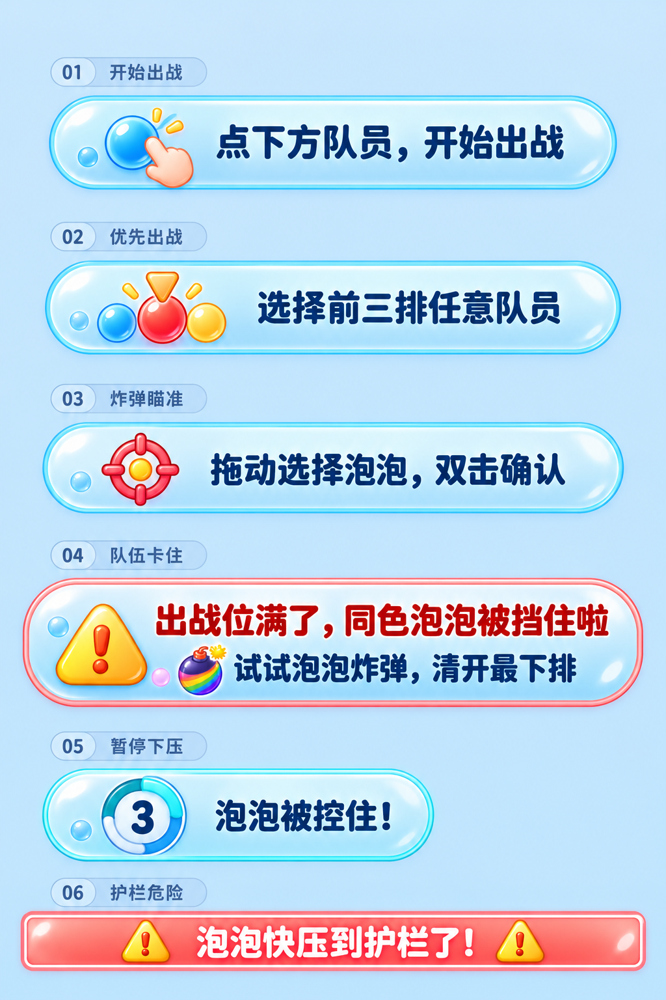
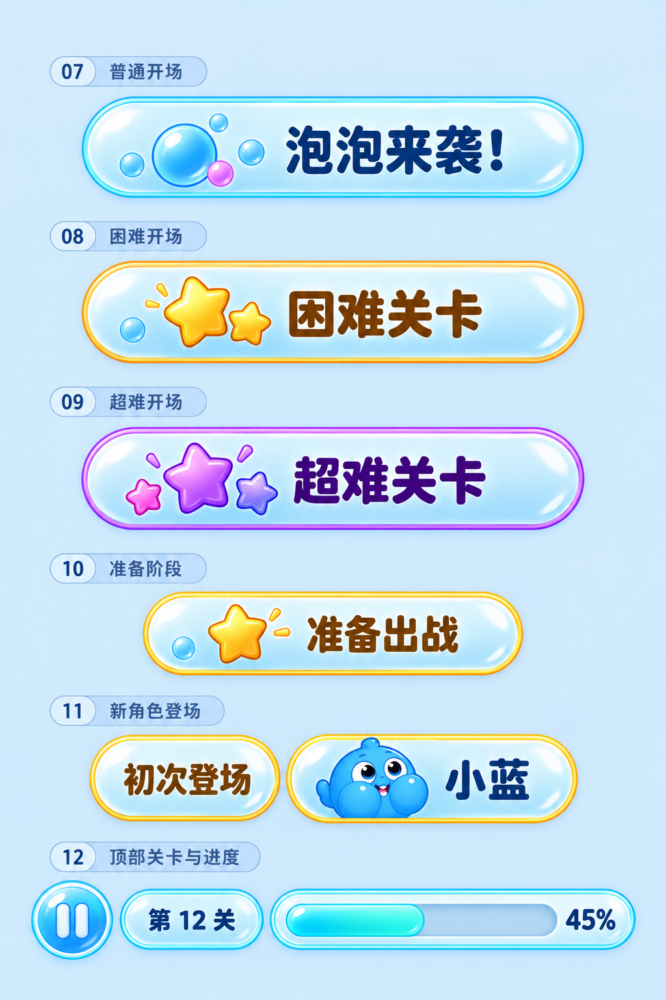
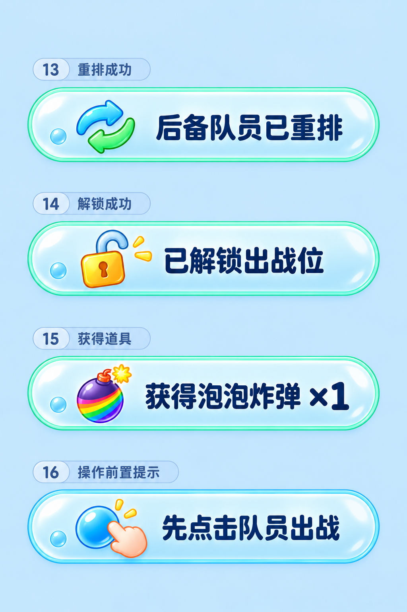
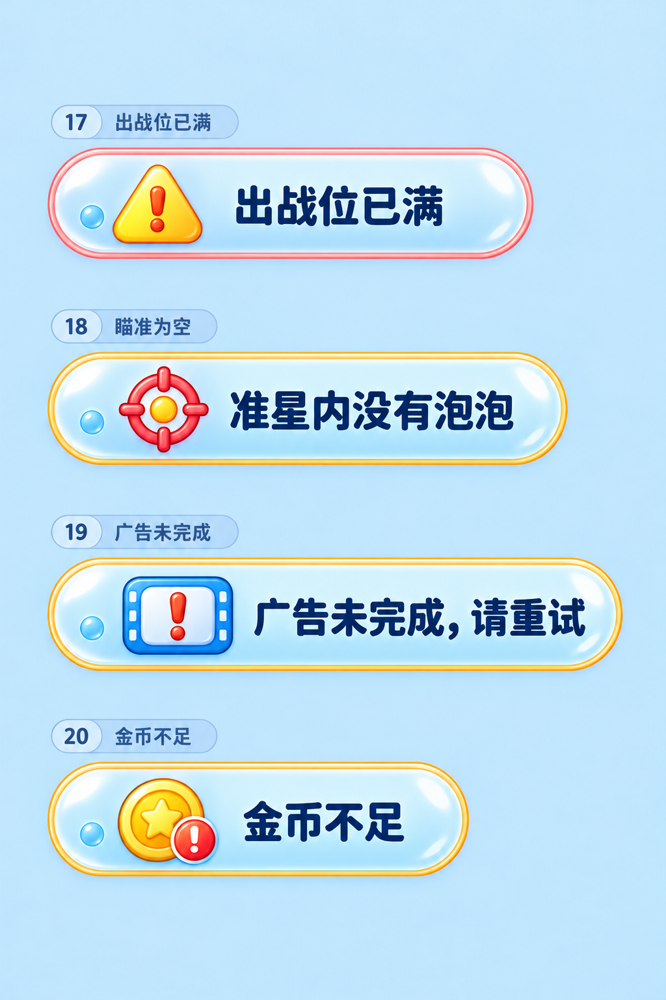
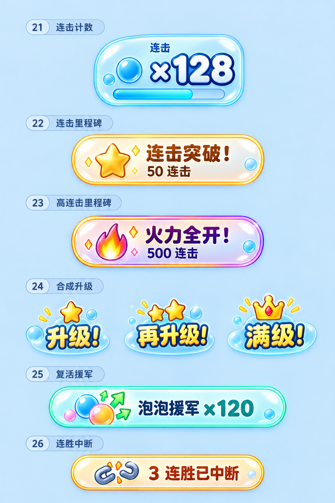
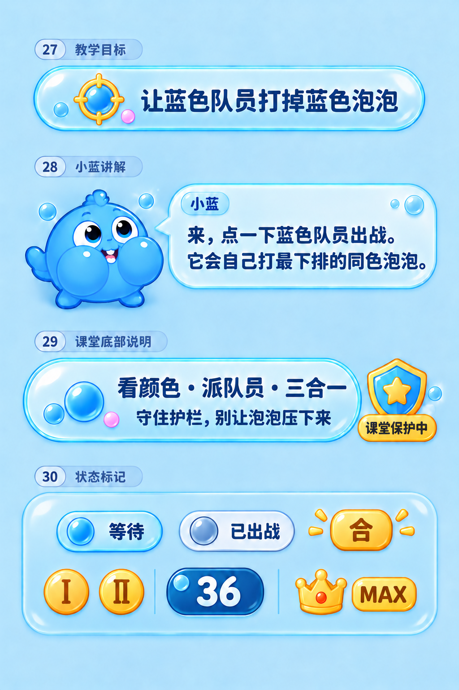
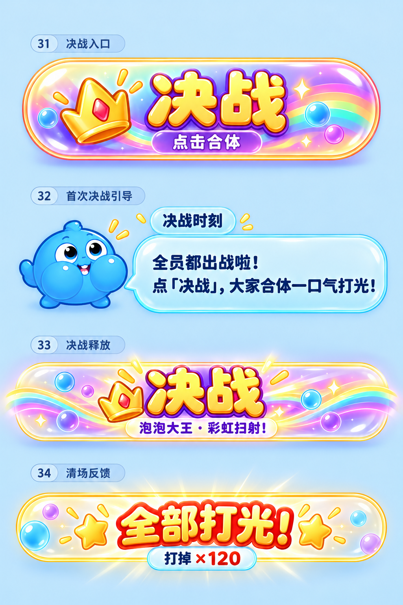

# 关卡页 UI 条统一设计

日期：2026-10-20。状态：设计提案，待确认后接入。

本方案以已确认的泡泡玻璃提示条为基准，梳理当前泡泡版关卡页的提示、警告、状态、短消息与战斗反馈，共形成 **34 个场景示意，分为 7 张展示板**。同一组件的文字和数字变体共用样式，不重复设计。

统一方向是：**轻薄玻璃底框、清楚的文字层级、按用途区分的边框颜色，以及能够区分提示和按钮的厚度。** 普通提示用平面胶囊，护栏危险用窄警示带，升级用小飘字，决战入口才使用明显的按钮体积。

本轮只新增设计文件。没有修改游戏代码、运行资源、图集或构建产物。展示板上的编号和场景名称是设计注释，不进入游戏；各组件经过放大展示，不能直接用展示板中的像素尺寸作为接入尺寸。

## 1 设计资料

| 展示板 | 场景编号 | 内容 |
|---|---|---|
| [01 操作与预警](../../Art/R1/ui-bars-design-20261020/01-操作与预警.png) | 01–06 | 开始出战、优先出战、炸弹瞄准、卡住、控住倒计时、护栏危险 |
| [02 开场与常驻](../../Art/R1/ui-bars-design-20261020/02-开场与常驻.png) | 07–12 | 普通、困难、超难开场，准备出战，新角色登场，关卡与进度 |
| [03 操作短反馈](../../Art/R1/ui-bars-design-20261020/03-操作短反馈.png) | 13–16 | 重排、解锁、获得道具、先出战提示 |
| [04 限制与异常](../../Art/R1/ui-bars-design-20261020/04-限制与异常.png) | 17–20 | 出战位满、准星为空、广告未完成、金币不足 |
| [05 战斗反馈](../../Art/R1/ui-bars-design-20261020/05-战斗反馈.png) | 21–26 | 连击计数、两档里程碑、三档升级、复活援军、连胜中断 |
| [06 教学与状态](../../Art/R1/ui-bars-design-20261020/06-教学与状态.png) | 27–30 | 教学目标、小蓝对话、课堂说明与保护、队员状态标签 |
| [07 决战流程](../../Art/R1/ui-bars-design-20261020/07-决战流程.png) | 31–34 | 决战入口、首次引导、释放横幅、清场反馈 |

风格参考：[已确认的提示条](../../Art/R1/ui-bars-design-20261020/reference-approved.png)。

生成记录：[每张图的提示词及修订提示词](../../Art/R1/ui-bars-design-20261020/prompts.json)。本轮使用内置 `image_gen`，图片是设计示意，不是可直接切图接入的最终素材。

## 2 当前 UI 的梳理结论

关卡页现在同时存在程序绘制的玻璃胶囊、图集里的蓝色横幅、无底框描边文字、开场的红色 WARNING、贴近护栏的红色警示带，以及角色上方的飘字。

这些形式各有用途，需要统一的是材质、颜色和文字规则。护栏警告必须一眼区别于普通提示；连击和升级必须保持轻盈，不能全部加厚底框。

当前短消息来自两处：顶部 `Toast` 和底部 `Battle.Notice`。相同性质的信息会落在不同位置，后续适合收拢到统一消息区。它们的现有显示时间分别约为 2.2 秒和 2.4 秒；这次设计不修改计时。

梳理范围以正在使用的 `Garden` 绘制路径和关卡 UI Prefab 为准。源码里旧空战版的同名横幅不再重复计入。暂停、设置、复活、胜败结算属于完整弹窗，本轮只覆盖其中会复用到关卡页的短消息；返回主页、前往下一关是整屏转场，也不改成提示条。底部道具和确认取消是操作按钮，不作为普通信息条重画；决战入口作为区分提示与按钮的对照纳入。

## 3 统一的视觉规则

### 3.1 共用材质

- 面板由乳白向浅蓝柔和过渡，避免大面积深蓝底。
- 外侧一圈细彩边，内侧一圈白色高光；底沿轻薄，不做厚重凸台。
- 高光主要放在上缘和左上角，不能穿过文字。
- 普通条最多一颗很小的装饰泡泡；紧凑版可以全部去掉。展示板中的装饰在接入时还需按实际尺寸收敛。
- 左侧用途图标一般占条高的 55%–65%，留足文字空间。
- 内容区由文字决定宽度，短消息不拉成满屏长条。

### 3.2 颜色与用途

| 用途 | 主文字 | 细边建议 | 辅助识别 |
|---|---|---|---|
| 普通操作、教学、常驻信息 | 深蓝 `#163E6D` | 天蓝 `#7CC4F0` | 指针、准星、目标等用途图标 |
| 操作成功、道具获得 | 深蓝 | 薄荷绿 `#4ACBA3` | 重排箭头、开锁、道具 |
| 条件不足、一般异常 | 深蓝或深琥珀 | 琥珀 `#F5B83A` | 感叹号与具体用途图标 |
| 队伍卡住、出战位已满 | 问题文字 `#B0302A`，办法用深蓝 | 珊瑚 `#F08A6C` | 黄色警告三角 |
| 护栏即将失守 | 白字 | 珊瑚红警示带 | 两端警告符号、贴护栏的位置 |
| 控住倒计时 | 深蓝 | 冰青 `#63D9E8` | 数字和倒计时环 |
| 初次登场、准备、普通里程碑 | 深蓝或深金棕 | 金色 | 小星星 |
| 超难、决战、高连击 | 深紫或金色 | 紫色与金色 | 三星、皇冠、火焰等 |
| 已出战等中性状态 | 深蓝灰 | 浅灰蓝 | 低饱和小标记 |

颜色必须与文字、图标、位置共同表达含义。困难关卡用金色、超难关卡用紫色；普通开场不再使用红色 WARNING。此项是设计建议，尚未修改现有开场表现。

### 3.3 提示与按钮

信息条内部保持连续底色。第二行不能单独套一个有底沿的蓝色胶囊，否则容易被误认为可点击。

真正的按钮可以有适度凸起、短底沿、按下反馈和明确动词。决战按钮内的「点击合体」是整个按钮的副文案，不是第二个独立按钮。

小蓝对话框保留指向头像的尾巴。状态标签、倒计时和进度槽不产生新的点击区域。

### 3.4 文字和尺寸

以下为 540 宽逻辑画布下的接入目标，延续现有尺寸为主。字号、尺寸必须通过实际手机宽度复核，展示板上的放大比例不作为依据。

| 组件 | 建议逻辑尺寸 | 文字与图标 |
|---|---|---|
| 单行操作提示 | 300–340 × 44–48 | 字号 19–21，图标约 26–30 |
| 双行卡住提示 | **420 × 66** | 第一行 18，第二行 16，警告图标约 40 |
| 短消息 | 内容自适应 × 38 | 字号 16–18，图标约 22–24 |
| 控住提示 | 236 × 54 | 正文约 22，倒计时数字约 20 |
| 护栏警示带 | **540 × 28** | 字号约 18，小警告符号 |
| 新角色名牌 | 单个约 96 × 36 | 名字约 16，头像沿用现有角色 |
| 角色状态 | 根据所在角色区域限宽 | 文字优先，装饰最少 |
| 决战入口 | 延续约 340 × 86 | 主副两级文案，保持现有点击范围 |

中文用圆润、清晰的粗体方向；落地时先验证项目字体的覆盖与字重。文字、百分比、数量、倒计时全部由程序绘制，不能烘焙进最终底框。

## 4 场景清单与样式

### 4.1 操作与预警

| 编号 | 当前出现情境 | 展示文案 | 设计处理 |
|---|---|---|---|
| 01 | 进入 Ready，等待第一次派队员 | 点下方队员，开始出战 | 天蓝单行条，轻点图标 |
| 02 | 进入优先出战选择 | 选择前三排任意队员 | 天蓝单行条，选择图标 |
| 03 | 炸弹瞄准期间 | 拖动选择泡泡，双击确认 | 通透天蓝条、准星；保留透出棋盘的能力 |
| 04 | Playing 且 Stalled，未选择道具、未打开设置 | 出战位满了，同色泡泡被挡住啦 / 试试泡泡炸弹，清开最下排 | 珊瑚边双行条，第二行保持平面 |
| 05 | `AdvanceHeld > 0`，未选择道具 | 泡泡被控住！ | 冰青条，真实剩余秒数与倒计时环 |
| 06 | 泡泡逼近护栏，达到现有警示阈值 | 泡泡快压到护栏了！ | 窄红色警示带，保留与护栏的关联 |

### 4.2 开场与常驻

| 编号 | 当前出现情境 | 展示文案 | 设计处理 |
|---|---|---|---|
| 07 | 普通关开场警示阶段 | 泡泡来袭！ | 天蓝短横条，移除通用英文 WARNING |
| 08 | difficulty 为 1 的开场 | 困难关卡 | 金边、双星 |
| 09 | difficulty 为 2 的开场 | 超难关卡 | 紫边、三星 |
| 10 | 开场后段 | 准备出战 | 小金边横条 |
| 11 | 某颜色角色首次登场 | 初次登场 / 角色名 | 金边名牌和真实角色头像；多个角色复用名牌 |
| 12 | 关卡常驻顶部 | 第 N 关 / P% | 关卡牌和进度槽统一玻璃材质，暂停仍为独立按钮 |

### 4.3 操作短反馈

| 编号 | 当前来源 | 统一展示文案 | 设计处理 |
|---|---|---|---|
| 13 | `Battle.Shuffle` 成功 | 后备队员已重排 | 薄荷绿边，重排图标 |
| 14 | `Battle.UnlockBay` 成功 | **已解锁出战位** | 薄荷绿边，开锁图标 |
| 15 | 道具广告奖励发放 | 获得泡泡炸弹 ×1 | 薄荷绿边；重排、优先出战共用模板并换图标 |
| 16 | 战斗尚未开始时使用受限道具 | 先点击队员出战 | 天蓝提示 |

当前解锁原文为「已解锁战机位」，经过现有 `GardenWords` 的替换顺序会成为「已解锁队员位」。建议在展示层明确映射为「已解锁出战位」。道具名「指定」也建议统一显示为界面上的「优先出战」。这些是文案建议，不改模型存储或操作规则。

### 4.4 限制与异常

| 编号 | 当前来源 | 展示文案 | 设计处理 |
|---|---|---|---|
| 17 | 尝试派队员但出战位已满 | 出战位已满 | 珊瑚边短条；区别于 04 的持续卡住说明 |
| 18 | 确认炸弹，但准星内没有目标 | 准星内没有泡泡 | 琥珀边、准星 |
| 19 | 广告流程未完成 | 广告未完成，请重试 | 琥珀边、视频异常图标 |
| 20 | 补充体力的金币检查失败 | 金币不足 | 琥珀边、金币图标；仅随现有分支出现 |

20 是代码现存的经济流程消息，不意味着要在战斗 HUD 新增金币、体力或商店入口。

### 4.5 战斗反馈

| 编号 | 当前出现情境 | 展示文案或变体 | 设计处理 |
|---|---|---|---|
| 21 | 连击计数出现 | 连击 ×N | 右上紧凑数字牌，附细倒计时槽 |
| 22 | 50 / 100 / 250 连击里程碑 | 连击突破！ / N 连击 | 轻薄金边短横条 |
| 23 | 500 / 1000 连击里程碑 | 火力全开！ / N 连击 | 金紫细边、小火焰 |
| 24 | 三档合成升级 | 升级！ / 再升级！ / 满级！ | 角色上方小飘字；星星递增，满级皇冠 |
| 25 | 复活清除演出 | 泡泡援军 ×N | 薄荷绿轻条，实际清除数量 |
| 26 | 连胜被中断后有提示 | N 连胜已中断 | 琥珀边短消息 |

21 的示例值 128、25 的 120、26 的 3 都只是设计样本。连击触发值、生命计时和援军清除规则继续取现有数据。

### 4.6 教学与角色状态

| 编号 | 当前出现情境 | 展示文案或变体 | 设计处理 |
|---|---|---|---|
| 27 | 教学当前目标 | 让蓝色队员打掉蓝色泡泡等 | 天蓝目标条，文字随步骤切换 |
| 28 | 小蓝讲解 | 每次两行教学对话 | 真实小蓝头像、带尾巴的玻璃对话框 |
| 29 | 教学关底部说明与保护 | 看颜色 · 派队员 · 三合一 / 守住护栏，别让泡泡压下来；课堂保护中 | 底部轻条和小盾牌标签 |
| 30 | 角色和队列局部状态 | 等待 / 已出战 / 合 / 剩余数量 / Ⅰ / Ⅱ / MAX | 微型标签；已出战用中性灰蓝，等级保留金色 |

27 共用模板的现有目标文案还包括：「再派两个蓝色队员，合成！」「合成成功，队员变强了！」「看最下排泡泡的颜色，换队员」「留意脚下数字，守住护栏」「队员打完了，及时接力」「打光泡泡，守住护栏」。

28 共用同一对话框，覆盖点击出战、三合一、合成效果、颜色被挡、按颜色派出、剩余数量、队员接力、决战说明八组讲解。示意图只展示第一组，其他组只换文字和已有表情。

30 的大背景托板只是展示分组，不进入游戏。Ⅰ和Ⅱ是两种等级的并列示例，不会同时挂在同一角色身上；数字、等级、皇冠沿用目前各自的位置。

### 4.7 决战流程

| 编号 | 当前出现情境 | 展示文案 | 设计处理 |
|---|---|---|---|
| 31 | 决战按钮达到原有可见条件 | 决战 / 点击合体 | 金紫彩虹主按钮；「点击合体」是新增副文案建议 |
| 32 | 首次决战引导 | 决战时刻；全员都出战啦！ / 点「决战」，大家合体一口气打光！ | 标题、小蓝头像和轻对话框 |
| 33 | 决战放招演出 | 决战 / 泡泡大王 · 彩虹扫射！ | 轻薄金紫演出横幅，无点击感 |
| 34 | 决战清场与战绩反馈 | 全部打光！ / 打掉 ×N | 轻薄金边庆祝条与小统计标签 |

32 原本还有「全员已出战 · 泡泡不到 N 个」条件说明，后续可以保留为标题下的小字，数值取 `Battle.FinaleThreshold`。示意图简化了这行来突出对话样式，不表示取消条件。34 把两项反馈放在一组展示，它们仍按各自原有时间和位置出现，不要求强行合成同一条。

## 5 摆放与并发显示建议

这一节是后续接入建议，不是当前已经具备的行为。

1. **常驻顶栏与连击各留位置。** 关卡和进度留在顶部；短消息放在顶栏下方偏左的预留区，右侧留给紧凑的连击计数，不让长消息覆盖连击数字。
2. **同一消息区一次只显示一条。** 当前顶部 Toast 与底部 Notice 可以统一表现，成功消息不打断需要玩家立即处理的提示。
3. **操作提示按模式切换。** 开始出战、优先出战、炸弹瞄准分别服务对应阶段，不同时堆叠。沿用暂停、设置、教学和决战现有的显隐约束。
4. **卡住说明与满位短提示去重。** 04 已显示时，不再重复叠加 17；离开卡住状态及时收起 04。
5. **危险提示贴近护栏。** 06 保持专用窄带，不放到中央遮图；倒计时、一般成功消息不能占用它的位置。危险阈值与游戏计时不改。
6. **新角色标签只在开场短时展示。** 延续目前停留后飞入队列的表现；多角色时压缩间距或分批展示，不能挡住顶部关卡牌。
7. **升级跟随角色。** 24 不升格为中央大横幅，三个等级都限制在角色附近；小状态标记不遮住数量牌。
8. **教学与首次决战引导有独立层级。** 保留原有输入与遮罩规则，隐藏不相关的普通提示；普通短消息不能盖住引导正文。
9. **瞄准保持可见棋盘。** 03 延续目前较透明的填充方向，确认和取消仍留在队列区，不能为了统一风格把按钮移回泡泡阵。

当前重要锚点可作为接入起点：开始出战提示中心 y=600，卡住提示 y=312，优先出战提示 y=512，瞄准提示 y=140，控住提示 y=240，护栏警示带 y=509、高 28。长屏应继续经过现有布局映射，组件内部比例保持不变。

## 6 素材和接入建议

确认设计后再拆正式素材，建议共用以下小集合，而不是给 34 个场景各做一张带字大图：

- 可拉伸的轻薄玻璃底框：蓝、绿、琥珀、珊瑚、冰青、金、紫等细边变体。
- 护栏窄警示带；对话框底板；微型状态牌；进度与倒计时槽。
- 手指、选择、准星、警告、重排、开锁、泡泡炸弹、视频异常、金币、星星、火焰、皇冠、盾牌等独立图标。
- 决战按钮作为可点击组件单独制作，不与普通提示共用厚度。
- 小蓝和其他队员头像继续来自现有角色素材。

文字、数字、填充量、倒计时圆环由程序负责。底框缩放保护两端圆角，图标保持等比。展示板的文字描边、装饰、高光应在 540 宽和较窄手机宽度下再检查，重点防止图标过大、字重过厚、提示遮挡底排泡泡。

建议接入顺序：01–06 → 13–20 → 07–12 → 27–30 → 21–26 → 31–34。先处理高频提示，再处理教学和演出。每批只改表现，不改变出战、道具消耗、合成、危险判定和决战条件。

## 7 源码依据

| 来源 | 本轮核对内容 |
|---|---|
| [PixelWingGame.Garden.cs](../../UnityProject/Assets/Flightbeat/Garden/PixelWingGame.Garden.cs) | Ready、Stalled、操作提示、控住、Toast、Notice、教学、角色状态 |
| [PixelWingGame.BubbleRail.cs](../../UnityProject/Assets/Flightbeat/Garden/PixelWingGame.BubbleRail.cs) | 护栏危险带、阈值与显隐 |
| [PixelWingGame.GardenOpening.cs](../../UnityProject/Assets/Flightbeat/Garden/PixelWingGame.GardenOpening.cs) | 开场三档难度、准备出战、首次登场 |
| [GardenUi.cs](../../UnityProject/Assets/Flightbeat/Garden/PixelWingGame.GardenUi.cs) 与 [GardenBattleHeader.prefab](../../UnityProject/Assets/Flightbeat/Resources/GardenR1/UI/GardenBattleHeader.prefab) | 当前关卡牌、进度和教学显示 |
| [CombatFeedback.Garden.cs](../../UnityProject/Assets/Flightbeat/Garden/CombatFeedback.Garden.cs) | 连击计数、里程碑、合成飘字、复活援军 |
| [GardenSkin.cs](../../UnityProject/Assets/Flightbeat/Garden/GardenSkin.cs) 与 [GardenBattleControls.prefab](../../UnityProject/Assets/Flightbeat/Resources/GardenR1/UI/GardenBattleControls.prefab) | 教学目标、讲解文案、底部提示、数量与等级 |
| [PixelWingGame.BubbleFinale.cs](../../UnityProject/Assets/Flightbeat/Garden/PixelWingGame.BubbleFinale.cs) | 决战入口、首次引导、释放、清场和计数 |
| [Battle.Items.cs](../../UnityProject/Assets/Flightbeat/Model/Battle.Items.cs)、[Battle.Deployment.cs](../../UnityProject/Assets/Flightbeat/Model/Battle.Deployment.cs) | 底部 Notice 的真实来源 |
| [PixelWingGame.Items.cs](../../UnityProject/Assets/Flightbeat/Game/PixelWingGame.Items.cs)、[SuperAim.cs](../../UnityProject/Assets/Flightbeat/Game/PixelWingGame.SuperAim.cs)、[Ads.cs](../../UnityProject/Assets/Flightbeat/Game/PixelWingGame.Ads.cs)、[Energy.cs](../../UnityProject/Assets/Flightbeat/Game/PixelWingGame.Energy.cs) | 获得道具、准星为空、广告未完成、金币不足与连胜中断 |

调试证据流程中的「同色清屏，击碎 N 只怪物」不属于正常关卡玩家提示，不纳入正式样式。示意图中的 45%、3 秒、连击及清除数量都是静态展示值，接入后必须使用实时数据。
